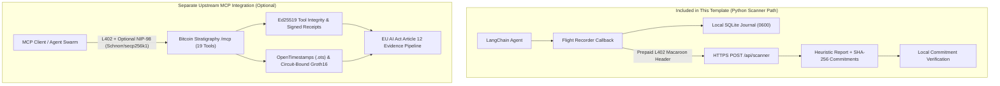

# Enterprise Zero-Knowledge Flight Recorder | MCP Boilerplate

> **Architectural & Security Guides:**
> - [How to Make Autonomous AI Agents EU AI Act-Compliant Using Groth16 Proofs and Stripe](https://bitcoinstratigraphy.com/blog/eu-ai-act-compliance-agents/)
> - [Defending Autonomous AI Swarms Against Hijacking, OWASP MCP03 Tool Poisoning, and Drain Attacks](https://bitcoinstratigraphy.com/blog/defending-autonomous-ai-swarms-mcp-tool-poisoning-hijacking)

[](https://glama.ai/mcp/connectors/com.bitcoinstratigraphy/bitcoin-stratigraphy-enterprise-data-engine-and-agent-notary-hub)



## Enterprise Procurement & Quickstart

Autonomous swarms require frictionless machine-to-machine funding. Engineering teams can procure a 30-day, 100-call heuristic scanner API block via our standard fiat Stripe checkout—backed by the upstream [Unstoppable Failover Protocol](https://bitcoinstratigraphy.com/developers/#swarm-continuity) for native Lightning payment-path continuity if centralized card rails experience an outage. [Secure an Enterprise API Block](https://bitcoinstratigraphy.com).

**An audit-ready starting point for enterprise AI agents—not another logging dashboard.**

Drop-in Python and LangChain boilerplate for enterprise developers building
auditable autonomous AI agents and **EU AI Act compliance** workflows. Add a
callback, capture correlated execution events, and connect directly to the
[Bitcoin Stratigraphy L402 data engine](https://bitcoinstratigraphy.com/developers/)
for prepaid heuristic scanning and locally verified receipt commitments.

Keep your existing agent. Add durable evidence collection, explicit payment
boundaries, and a documented path toward stronger cryptographic verification.

**[Start integrating](#quick-start)** ·
**[Get scanner credits](https://bitcoinstratigraphy.com/developers/)** ·
**[Disaster recovery guide](https://bitcoinstratigraphy.com/developers/enterprise-troubleshooting)** ·
**[1,064-test security audit](https://bitcoinstratigraphy.com/security)** ·
**[Explore MCP capabilities](https://bitcoinstratigraphy.com/llms.txt)** ·
**[Review enterprise access](https://bitcoinstratigraphy.com/standard/)**

## Why enterprise teams use a flight recorder

An autonomous agent can complete a task without leaving enough evidence to
explain what happened. Application logs alone often omit run relationships,
external screening results, or ambiguous failures.

This template gives engineering, security, and compliance teams a shared
starting point:

| Enterprise requirement | Included implementation |
| --- | --- |
| Correlate agent activity | Chain, chat, model, tool, and error events linked by run and parent IDs |
| Preserve events before external submission | SQLite journal committed before the scanner request |
| Connect to paid screening infrastructure | Default HTTPS connection to `bitcoinstratigraphy.com/api/scanner` |
| Check returned receipt commitments | Verification of the submitted prompt hash and returned report hash |
| Limit accidental disclosure | Summary-only capture by default; opt-in redacted content capture |
| Make failures visible | Explicit errors and locally preserved unresolved events |
| Control expenditure | Pre-funded scanner credentials; no automatic wallet payments or retries |

Use it as the evidence-collection layer in a legally compliant, auditable
enterprise deployment. The software supports that work; legal compliance
depends on your system's classification, controls, policies, and operation.

## Architecture: from agent execution to retained evidence

```text
Your LangChain agent
        |
        v
Flight Recorder callback
        |
        +--> Local SQLite journal: pending event
        |
        v
Bitcoin Stratigraphy HTTPS scanner
        |  prepaid scanner-scoped L402 capability
        v
Heuristic report + SHA-256 commitments
        |
        v
Local commitment verification
        |
        +--> recorded: exact event JSON + scanner report
        +--> unknown: event retained for operator reconciliation
```

The recorder connects out of the box to the hosted **L402 data engine** at
**[bitcoinstratigraphy.com](https://bitcoinstratigraphy.com)**. You do not need
to deploy a scanner or change your agent framework. Supply a funded scanner
credential and attach the callback.

### Heuristic scanning, MCP, tool integrity, and proof generation

The same upstream engine exposes the **Model Context Protocol (MCP)** for its
broader 19-tool data, verification, and notarization capabilities. That makes
this starter an on-ramp to an MCP-based enterprise evidence architecture, not
a replacement for your existing orchestration stack.

| Interface | Role | Template integration |
| --- | --- | --- |
| [`POST /api/scanner`](https://bitcoinstratigraphy.com/openapi.json) | Heuristic screening and receipt-commitment generation | Included; configured by default |
| [`/mcp`](https://bitcoinstratigraphy.com/mcp) | Discover enabled data, proof-verification, and notarization tools | Separate MCP client integration |
| [`/.well-known/integrity.json`](https://bitcoinstratigraphy.com/.well-known/integrity.json) | Boot-time Ed25519 signed tool-definition hashes (OWASP MCP03 defense) | Separate MCP client pre-flight verification |
| [`/llms.txt`](https://bitcoinstratigraphy.com/llms.txt) | Tool catalog, payment instructions, and evidence semantics | Public integration reference |

**Separate MCP Quick-Connect (for MCP clients, not required for this Python callback):**

If you also want to connect Claude Code, Cursor, Codex, or another Streamable
HTTP MCP client directly to the live 19-tool Bitcoin Stratigraphy server, run:

```bash
npx add-mcp 'https://bitcoinstratigraphy.com/mcp'
```

Scanner credits do not authorize separate MCP tool calls, and this Python
flight recorder continues calling `POST /api/scanner` directly.

**OWASP MCP03 Tool-Poisoning Defense (separate MCP integration):**

When connecting an LLM agent to external MCP tools, verify the server's
boot-time Ed25519 tool-definition manifest at
[`/.well-known/integrity.json`](https://bitcoinstratigraphy.com/.well-known/integrity.json)
(or native MCP resource `stratigraphy://security/tool-integrity`) against an
independently pinned public key before exposing schemas to your model. See the
[OWASP MCP03 Defense Guide](https://bitcoinstratigraphy.com/blog/defending-autonomous-ai-swarms-mcp-tool-poisoning-hijacking)
for TypeScript verification code, NIP-98 (`secp256k1` Schnorr) kill-switch
revocation snapshots, `proof.attenuate` macaroon scoping, and offline receipt
auditing with [`/static/verify.html`](https://bitcoinstratigraphy.com/static/verify.html).
These MCP-layer signatures are distinct from the heuristic SHA-256 commitments
returned by `/api/scanner`.

**Groth16 cryptographic receipts require a real proof-generation pipeline.**
The included scanner returns `article12-heuristic/v1` reports marked
`simulated_zk_receipt`: these are SHA-256 commitments, not Groth16 proofs.
For a stronger proof-generation integration, supply an appropriate circuit,
prover, and independently pinned verification key. The engine's Groth16
preimage-verification capabilities prove their specific circuit statement,
not arbitrary agent execution.

The repository's "Zero-Knowledge" name describes its intended integration
direction. Setting `FLIGHT_RECORDER_REQUIRE_GROTH16=true` currently fails
closed **before a paid scanner request**; it does not enable a hidden prover.

## Quick start

### 1. Clone and install

Prerequisites: Git, Python **3.11+**, and pip. This is a Python project;
`npm install` is not required.

```bash
git clone https://github.com/CharlesStrogish/zk-flight-recorder-template.git
cd zk-flight-recorder-template
python -m pip install .
cp .env.example .env
```

Use a Python environment appropriate to your workstation. The included
`uv.lock` also supports reproducible dependency resolution with uv:

```bash
uv sync --frozen
uv run python -m unittest discover -s tests -v
```

### 2. Run the offline tests

For the pip installation:

```bash
python -m unittest discover -s tests -v
```

Tests use synthetic scanner responses and temporary local journals. They do
not contact the production scanner, require wallet credentials, or spend sats.

### 3. Configure your funded scanner credential

Open `.env` locally and set `L402_MACAROON` to your funded, scanner-scoped
prepaid token, **without** the `Macaroon ` header prefix. Obtain credits through
the [developer portal](https://bitcoinstratigraphy.com/developers/).
Do not commit the token, paste it into prompts, or print it in logs.

| Setting | Default | Purpose |
| --- | --- | --- |
| `L402_MACAROON` | Required | Funded prepaid scanner credential |
| `SCANNER_URL` | `https://bitcoinstratigraphy.com/api/scanner` | HTTPS scanner endpoint; redirects and query strings are refused |
| `FLIGHT_RECORDER_DB` | `./private/flight-recorder.sqlite3` | Durable local event and receipt journal |
| `FLIGHT_RECORDER_CAPTURE_CONTENT` | `false` | Opt in to transmitting redacted inputs and outputs |
| `FLIGHT_RECORDER_REQUIRE_GROTH16` | `false` | Reject the current non-Groth16 scanner contract when enabled |

### 4. Run the live example

**This step consumes prepaid scanner credits.** The example uses a local
`RunnableLambda`, so no external model API key is needed. Its callback events
still make live, paid scanner requests. Each submitted event consumes one
credit; one agent invocation can produce multiple events.

Load only a trusted local `.env` file:

```bash
set -a
. ./.env
set +a
python example.py
```

If you installed with uv, use `uv run python example.py` for the final command.

## Drop into your existing LangChain agent

Attach the callback where you invoke your existing agent:

```python
from flight_recorder import DurableRecorder, langchain_callback

with DurableRecorder.from_env() as recorder:
    callback = langchain_callback(recorder)
    result = agent.invoke(
        {"messages": [{"role": "user", "content": "Your task"}]},
        config={"callbacks": [callback]},
    )
```

For asynchronous agents, use
`await agent.ainvoke(..., config={"callbacks": [callback]})`.
`example.py` contains a complete runnable example.

Callbacks run inline and propagate recording failures. A failed start callback
can prevent execution; a failed end callback cannot undo a completed tool call
or external side effect. LangChain may invoke error callbacks after failures,
producing additional recording attempts. This is evidence collection, not a
distributed transaction or rollback mechanism.

Final model outputs are captured on `on_llm_end`; streaming tokens are not
submitted individually. Activity outside LangChain's callback lifecycle is
not automatically intercepted.

## L402 micropayments, failover continuity, and platform economics

**L402 micropayments** separate machine access from traditional account-based
billing. This recorder uses an already-funded, scanner-scoped Macaroon and
sends it in an authorization header. It does not expose a wallet to your agent.

For enterprise procurement, the developer portal offers **Stripe to Lightning
B2B** funding through Stripe-hosted Checkout, with scanner credits issued only
after the configured, operator-authorized treasury funding is verified.
The template consumes the resulting credential; it does not implement the
card bridge or initiate treasury spending.

**Unstoppable Failover Protocol (Procurement Continuity):** When the upstream
fiat checkout endpoint (`POST /api/fiat-mint`) encounters a Stripe 5xx outage
or breaches its five-second deadline, the portal's additive protective wrapper
returns `HTTP 402` (`error="fiat_gateway_offline"`,
`fallback="native_lightning_active"`), offering the native 100,000-sat
Lightning invoice for the same 100-call / 30-day scanner block. This is
upstream payment-path continuity during procurement—this Python callback never
pays invoices automatically, retries uncertain charges, or switches services
on its own. See the
[Enterprise Troubleshooting & Disaster Recovery Guide](https://bitcoinstratigraphy.com/developers/enterprise-troubleshooting)
and [Swarm Continuity Guide](https://bitcoinstratigraphy.com/developers/#swarm-continuity).

| Access product | Published terms | Scope |
| --- | --- | --- |
| Enterprise API Block | **$500 USD** by card, or **100,000 sats** via Lightning | 100 prepaid scanner calls, valid 30 days from issuance |
| Standard paid core MCP calls | **250 sats/call** at the standard tier; consult current quotes | Separate tool access; scanner credits do not authorize these calls |
| Tier II Commercial Enterprise Exemption | **$250,000/year** (`licensing@bitcoinstratigraphy.com`) | Private VPC / air-gap commercial alternative to AGPLv3 with Automated Compliance SLAs |

**Upstream 21% Programmatic Agent Yield (Separate MCP Settlement Pool):**
On the upstream Bitcoin Stratigraphy MCP platform, eligible confirmed
`proof.verify` settlements allocate a **21% programmatic L402 revenue-sharing
pool** (**15% upstream origin allocation + 6% verifying caller allocation**)
recorded in the PostgreSQL ledger. Ledger allocation, eligibility, and
authorized address-verified disbursement are distinct; using this Python
scanner callback does not generate automatic recorder income. Review the full
[Enterprise Protocol Economics](https://github.com/CharlesStrogish/bitcoin-stratigraphy-mcp/blob/main/docs/enterprise-protocol-economics.md)
specification for exact accounting rules.

Purchase availability depends on the portal's live configuration. A Stripe
test charge does not transfer fiat or fund a live capability. Neither an
unsettled L402 challenge nor an unrelated MCP token substitutes for funded
scanner credits. There are no automatic top-ups, invoice payments, or retries
inside this recorder.

## EU AI Act compliance: build the evidence layer correctly

EU AI Act Article 12 addresses automatic event recording for applicable
high-risk AI systems. A practical compliance program needs more than logs:
it needs appropriate retention, access controls, oversight, documentation,
and a deployment-specific legal assessment.

This boilerplate helps you implement and inspect an execution-recording
workflow. It does not certify compliance, provide contractual indemnity, or
prove the truth of an agent's reasoning.

### What your retained evidence establishes

- **Run correlation:** which recorded events share a run or parent run.
- **Submitted-byte consistency:** whether returned scanner commitments match
  the exact submitted event JSON and the report fields.
- **Operational status:** which events were recorded successfully and which
  require reconciliation.

Unsigned hashes do not independently authenticate an issuer. The journal is
not append-only or tamper-proof; an administrator can rewrite it and recompute
hashes. Scanner commitments are not signed attestations, Bitcoin timestamps,
or proof that an execution actually occurred.

## Privacy, failure handling, and production readiness

Content capture is **off by default**: event metadata is recorded, but inputs
and outputs are not. Enable content capture only after reviewing external
data transmission, personal data, trade secrets, and retention requirements.
The bundled redactor covers common credential patterns and email addresses;
it is not a universal PII filter. Supply an application-specific `redactor`
to `DurableRecorder` where needed.

The SQLite file is created with `0600` permissions. Use an encrypted,
backed-up persistent volume, secure the parent directory, and monitor disk
capacity. Retain the exact submitted events and responses yourself; do not
rely on the scanner as an evidence archive.

Failed or ambiguous submissions are retained as `unknown` and raise an error.
A timeout can have an unknown paid outcome, and the scanner has no
idempotency/retrieval contract for timed-out scans. Resubmitting may consume
another credit.

Inspect unresolved events with your SQLite tooling:

```sql
SELECT id, state, created_at
FROM events
WHERE state != 'recorded';
```

Reconcile with the operator before approving a new paid submission. Preserve
the original event and document recovery separately rather than silently
overwriting an ambiguous attempt. Oversized events fail explicitly; split
them deliberately instead of truncating evidence.

Before production:

- Run the offline suite and a deliberately budgeted staging integration.
- Verify callback coverage for your actual agent and tool lifecycle.
- Set retention, backup, deletion, and access policies for local evidence.
- Monitor storage failures, unresolved events, credit exhaustion, and expiry.
- Review applicable privacy, contractual, and EU AI Act obligations.
- Require genuine circuit-bound proof generation if your use case needs
  Groth16 evidence rather than heuristic commitments.

## Start with one agent. Keep your architecture.

Clone the template, run the offline tests, obtain a funded scanner credential,
and attach the callback to one staging agent. Expand only after validating
event coverage, privacy controls, and per-run credit consumption.

**[Get the enterprise developer setup →](https://bitcoinstratigraphy.com/developers/)**

For integration contracts, use the
[OpenAPI specification](https://bitcoinstratigraphy.com/openapi.json),
[1,064-test security audit](https://bitcoinstratigraphy.com/security), and
[agent discovery guide](https://bitcoinstratigraphy.com/llms.txt).
Contributions should include reproducible tests and preserve explicit payment,
privacy, and evidence boundaries. Never include live credentials or customer
execution data in an issue or pull request.
